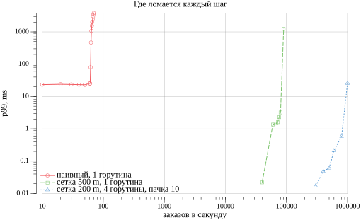

# geomatch

geomatch находит ближайших водителей к заказу, как диспетчер такси. В памяти лежит индекс на 100 тыс. водителей. Каждый присылает координаты раз в 2 секунды, это 50 тыс. обновлений в секунду, и на каждый заказ индекс отдаёт 5 ближайших.

Проект про то, как ускорять такой поиск и честно его мерить. Нагрузку даёт свой генератор. Заказы идут по расписанию, и задержка считается от момента, когда заказ должен был прийти. Если индекс не успевает, заказы копятся в очереди, и это сразу видно в p99.

Индекс можно нагружать двумя способами. Генератор вызывает его напрямую в своём процессе или ходит по gRPC в отдельный сервис `matcher`. Координаты водителей сервис может получать через шлюз `gateway` и Kafka. Вместо своей сетки индексом может быть Redis. Сервис умеет назначать заказ: предлагает его ближайшему свободному водителю, ждёт ответа и при отказе или молчании идёт к следующему. Кто из водителей занят, хранится в Redis. Postgres будет дальше.

## Запуск

Нужен Go 1.27.

```
$ make build
$ INDEX=grid ORDER_WORKERS=4 UPDATE_BATCH=10 ORDER_RATE=200000 ./bin/loadgen
```

Прогон идёт 30 секунд. Итог пишется в лог и в `results.json`: число заказов и p50, p99, p99.9, max в микросекундах.

То же через сеть, сервис в одном терминале и генератор в другом:

```
$ ./bin/matcher
$ MATCHER_ADDR=localhost:50051 MATCHER_CONNS=4 ORDER_INFLIGHT=1000 UPDATE_BATCH=10 ORDER_RATE=100000 ./bin/loadgen
```

Весь стек в Docker: Kafka, шлюз, сервис, генератор водителей через шлюз, генератор на 1 000 заказов/с, Prometheus и Grafana с готовым дашбордом.

```
$ make up
```

Grafana на http://localhost:3000, Prometheus на http://localhost:9090. Остановить `make down`.

Водители через Kafka без Docker для всего, кроме Kafka:

```
$ docker compose up -d kafka
$ KAFKA_BROKERS=localhost:9094 ./bin/matcher
$ ./bin/gateway
$ MATCHER_ADDR=localhost:50052 ORDER_RATE=0 UPDATE_BATCH=10 DURATION=1h ./bin/loadgen
$ MATCHER_ADDR=localhost:50051 DRIVERS=0 MATCHER_CONNS=4 ORDER_INFLIGHT=1000 ORDER_RATE=10000 ./bin/loadgen
```

Индекс в Redis, генератор ходит в него из своего процесса:

```
$ docker compose --profile redis up -d redis
$ INDEX=redis ORDER_INFLIGHT=1000 DRIVER_WORKERS=4 UPDATE_BATCH=10 ORDER_RATE=10000 ./bin/loadgen
```

Назначение заказов. Генератор создаёт заказы и сам играет водителей, которые отвечают на предложения:

```
$ docker compose --profile redis up -d redis
$ ASSIGN=true OFFER_TIMEOUT=1s ./bin/matcher
$ MATCHER_ADDR=localhost:50051 ASSIGN=true MATCHER_CONNS=16 ORDER_INFLIGHT=1000 UPDATE_BATCH=10 ORDER_RATE=10000 RIDE_TIME=1s OFFER_DECLINE=0.1 OFFER_IGNORE=0.05 ./bin/loadgen
```

В итог добавляются назначенные заказы, заказы без водителя, ошибки и двойные назначения. Если водитель получил заказ посреди поездки, генератор завершается с ошибкой.

Основные настройки генератора:

```
DRIVERS=100000      водителей
UPDATE_PERIOD=2s    как часто водитель шлёт координаты
ORDER_RATE=1000     заказов в секунду
DURATION=30s        длительность прогона
INDEX=naive         naive, grid или redis
CELL_SIZE=200       размер клетки сетки, m
REDIS_ADDR=localhost:6379
REDIS_RADIUS=250    с какого радиуса начинать поиск в Redis, m
ORDER_WORKERS=1     горутин заказов
ORDER_INFLIGHT=0    сколько заказов горутина шлёт, не дожидаясь ответа, 0 ждёт каждый ответ
UPDATE_BATCH=1      обновлений водителей в одной записи в индекс
SEED=1              сценарий случайных чисел
MATCHER_ADDR=       адрес сервиса, без него индекс живёт в процессе генератора
MATCHER_CONNS=1     соединений с сервисом
DRIVER_CONNS=0      у каждого водителя свой поток, на столько соединений, 0 общий поток
DRIVER_ADDRS=       адреса сервиса для соединений водителей через запятую, по умолчанию MATCHER_ADDR
METRICS_ADDR=       адрес для метрик Prometheus, пусто без метрик
ASSIGN=false        заказы через назначение, нужен MATCHER_ADDR и сервис с ASSIGN=true
OFFER_DECLINE=0     доля предложений, от которых водитель отказывается
OFFER_IGNORE=0      доля предложений, на которые водитель не отвечает
RIDE_TIME=5s        сколько длится поездка
```

`DRIVERS=0` или `ORDER_RATE=0` запускает генератор только с заказами или только с водителями.

Настройки сервиса:

```
LISTEN_ADDR=:50051  адрес, на котором слушает сервис
INDEX=grid          grid или redis
CELL_SIZE=200       размер клетки сетки, m
REDIS_ADDR=localhost:6379
REDIS_RADIUS=250    с какого радиуса начинать поиск в Redis, m
DRIVER_TTL=10s      через сколько молчания водитель удаляется из индекса
SHUTDOWN_TIMEOUT=5s сколько ждать открытые вызовы при остановке
MAX_CONNS=150000    больше соединений сервис не принимает
METRICS_ADDR=:2112  адрес для метрик Prometheus
KAFKA_BROKERS=      адреса Kafka через запятую, без них координаты только по gRPC
KAFKA_TOPIC=driver-positions
KAFKA_PARTITIONS=8  разделов, если топик создаёт сервис
ASSIGN=false        назначать заказы, состояния водителей в Redis по REDIS_ADDR
CANDIDATES=10       скольким ближайшим водителям можно предложить заказ за раз
MAX_OFFERS=3        скольким водителям по очереди предлагается заказ
OFFER_TIMEOUT=10s   сколько ждать ответа водителя
```

Настройки шлюза: `LISTEN_ADDR=:50052`, `METRICS_ADDR=:2113`, `KAFKA_BROKERS=localhost:9094`, `KAFKA_LINGER=10ms`, сколько раздел ждёт новых записей перед отправкой. `KAFKA_TOPIC`, `KAFKA_PARTITIONS`, `MAX_CONNS` и `SHUTDOWN_TIMEOUT` как у сервиса.

`matcher -health` проверяет запущенный сервис через gRPC health, так работает healthcheck в Docker.

## Что получилось

Все цифры с одной машины: i7-12700H, 20 потоков, режим процессора performance, медиана по 5 прогонам. Таблицы и команды лежат в [RESULTS.md](RESULTS.md), причины решений в [DECISIONS.md](DECISIONS.md).

| Шаг                                               | Держит заказов/с | p99 на пределе | Ломается на |
|---------------------------------------------------|------------------|----------------|-------------|
| Перебор всех водителей с сортировкой, 1 горутина  |               61 |        25.4 ms |          62 |
| Сетка из клеток 500 m, поиск кольцами, 1 горутина |           80 000 |         3.2 ms |      90 000 |
| Сетка 200 m, RWMutex, 4 горутины, пачки по 10     |          800 000 |       0.587 ms |   1 000 000 |
| Та же сетка в сервисе за gRPC, 4 соединения       |          200 000 |       2.477 ms |     240 000 |

Наивный индекс мерил до исправлений генератора и не перемерял: ошибка генератора была около 1-3 ms, а сам поиск занимал 17-25 ms.



Наивный индекс упирается в сортировку 100 тыс. водителей на каждый заказ, по профилю это около 60% времени. Сетка смотрит только клетки рядом с заказом и останавливается, когда дальше ближе никого быть не может.


С одной горутиной заказов сетка упиралась в одно ядро. С несколькими горутинами нужен замок: RWMutex пускает поиски параллельно, а обновления водителей пачками останавливают их реже.

Через gRPC та же сетка держит в 4 раза меньше. По профилю сервиса поиск занимает около 10% процессора, а треть уходит на системные вызовы сети. Сервис и генератор стоят на одной машине и делят процессор, поэтому это предел их пары.

Если у каждого водителя свой поток, как у настоящих телефонов, сервис держит 100 000 соединений. Они подключаются за 7 секунд, память сервиса 3.5-4.3 GB вместо 70 MB, p99 при 10 000 заказов/с 18.895 ms вместо 0.215 ms. Эмуляция 100 000 телефонов сама занимает 5.8 GB и перегревает процессор в каждом прогоне, поэтому сколько хвоста даёт сервис, на одной машине не разделить.

Через шлюз и Kafka позиция водителя доходит до индекса за 15 ms по p99, а p99 заказов при 10 000/с 0.241 ms против 0.226 ms напрямую. После `kill -9` сервис перечитывает из Kafka только позиции за последние `DRIVER_TTL`, и со 100 000 водителей снова готов через 0.26 секунды.

Redis с `GEOSEARCH` вместо своей сетки при 10 000 заказов/с даёт p99 0.206 ms против 0.011 ms. Сам поиск по статистике Redis занимает около 12 us. С клиентом rueidis при 60 000 заказов/с p99 0.593 ms, при 80 000 уже 2.433 ms. С go-redis очередь растёт без конца с 60 000 заказов/с, p50 0.73 s. Поиск начинается с 250 m. При 1000 m один поиск в Redis стоит 84 us и p99 1.529 ms, при 100 m почти на каждый заказ нужен второй поиск.

Назначение заказа при 100 000 водителях держит 30 000 заказов/с с p99 2.809 ms, при 40 000 заказов/с очередь растёт без конца, p50 0.334 s. Redis при этом занят на 0.67 ядра, а сервис и генератор вместе тратят около 10 ядер. На каждый заказ приходится три вызова gRPC и три Lua-скрипта: предложить, принять, завершить поездку. Двойных назначений ни в одном прогоне. Lua-скрипт, который за один обмен с Redis проходит 10 кандидатов, против `SET NX` по очереди: когда свободных много, разницы нет, когда водители заняты, p99 0.590 ms против 1.170 ms.

С отказами 10% и молчанием 5% водителей при `OFFER_TIMEOUT=1s` и 10 000 заказов/с p50 0.443 ms, p99 1.001 s, это заказы, где первый водитель промолчал. Без водителя остаются 1 029 заказов из 300 000. Это та доля, когда все три водителя подряд отказались или промолчали, 0.15 в кубе. С 4 соединениями вместо 16 заказы ждали в очереди: 5% молчаний держат около 500 заказов по секунде, а сервер пускает 100 потоков на соединение.

Сервис проверен на двух плохих клиентах. Один шлёт 100 тыс. водителей одним сообщением, другой шлёт запросы и не читает ответы. Без защиты первый поднимал чужой p99 до 10 ms, второй за 30 секунд раздувал память сервиса до 2.9 GB. С защитой p99 в обоих случаях около 0.33 ms, память во втором 63 MB.

## Что не сработало

- 8 шардов по ID водителя. Поиск всё равно идёт по всем шардам, при 200 000 заказов/с не успевает.
- Одна горутина владеет индексом, остальные шлют ей запросы в канал. Упирается в одно ядро, при 300 000/с p50 больше секунды.
- Пирамида сеток разного размера для редких водителей. При плотном центре и пустых окраинах 70 us против 11 us у одной сетки.
- `Nearest` без аллокации. GC стал запускаться в 6 раз реже, но задержка не изменилась.
- `GOGC` и `GOMEMLIMIT`. Меняют только память, на задержку не влияют.
- Горутины генератора, которые ждут ответ по сети. При 50 горутинах и 50 000 заказов/с p50 0.525 ms против 0.074 ms, генератор занимает 15 ядер.
- 10 соединений с сервисом вместо 4. При 140 000/с p99 1.256 ms против 0.956 ms.
- go-redis вместо rueidis для индекса в Redis. При 50 000 заказов/с p99 5.171 ms против 0.400 ms, при 60 000 очередь растёт без конца.

Ещё был случай с генератором. Хвост около 3 ms долго выглядел как проблема индекса. Через `runtime/trace` нашлось, что горутины генератора, ожидая время следующего заказа, крутились в цикле и не отдавали ядро, а разбуженные поиски стояли в очереди. После исправления p99 при 200 000/с упал с 0.211 до 0.050 ms.

## Упрощения

- Расстояние считается по прямой. Настоящее такси считает время в пути по дорогам.
- Один город, клетка одного размера на весь город.
- Сеть только loopback. Сервис и генератор на одной машине, настоящая сеть добавит задержку.
- Число соединений ограничено `MAX_CONNS`, но молчащий поток держится, пока жив его TCP. 10 000 открытых молчащих потоков поднимают p99 с 0.324 до 1.202 ms.
- Событий заказа в Kafka нет, заказы и поездки нигде не сохраняются. Это будет вместе с Postgres.
- Все водители читают один общий поток предложений, а не каждый свой.
- Таймеры предложений живут в памяти `matcher`. Если он упал, водитель освободится только по сроку жизни ключа в Redis.
- Одновременно ждущих заказов не больше 100 на соединение с сервисом.
- Kafka одним брокером без реплик.
- Redis один, без реплик и без сохранения на диск.

## Устройство

```
api/matcher/v1      описание gRPC API, make proto
cmd/loadgen         генератор нагрузки
cmd/matcher         gRPC-сервис с индексом и назначением заказов
cmd/gateway         шлюз: координаты водителей по gRPC в Kafka
internal/server     проверка запросов, таймаут молчащих водителей, чтение Kafka
internal/gateway    запись координат в Kafka
internal/feed       формат записи о водителе в Kafka, создание топика
internal/serve      общий gRPC-сервер: лимит соединений, keepalive, health, метрики
internal/client     клиент сервиса с интерфейсом индекса, поток на водителя
internal/pb         код, сгенерированный из protobuf
internal/index      индекс: naive и grid
internal/redisindex индекс в Redis через GEOSEARCH
internal/dispatch   назначение заказа, состояния водителей в Redis
internal/load       расписание заказов, движение водителей, ответы водителей, гистограмма задержек
internal/sim        город и модель движения водителя
internal/geo        точка, расстояние, смещение
internal/config     настройки из переменных окружения
internal/logging    JSON-логи через slog
tools/plot          графики для README, make plot
tools/badclient     плохие клиенты для проверки сервиса
deploy              Prometheus и дашборд Grafana для make up
```
