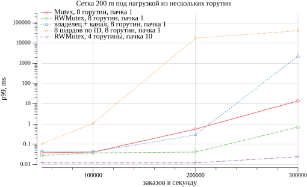

# geomatch

geomatch находит ближайших водителей к заказу, как диспетчер такси. В памяти лежит индекс на 100 тыс. водителей. Каждый присылает координаты раз в 2 секунды, это 50 тыс. обновлений в секунду, и на каждый заказ индекс отдаёт 5 ближайших.

Проект про то, как ускорять такой поиск и честно его мерить. Нагрузку даёт свой генератор. Заказы идут по расписанию, и задержка считается от момента, когда заказ должен был прийти. Если индекс не успевает, заказы копятся в очереди, и это сразу видно в p99.

Индекс можно нагружать двумя способами. Генератор вызывает его напрямую в своём процессе или ходит по gRPC в отдельный сервис `matcher`. Kafka, Redis и Postgres будут дальше.

## Запуск

Нужен Go 1.27.

```
$ make build
$ INDEX=grid ORDER_WORKERS=4 UPDATE_BATCH=10 ORDER_RATE=200000 ./bin/loadgen
```

Прогон идёт 30 секунд. Итог пишется в лог и в `results.json`: число заказов и p50, p99, p99.9, max в микросекундах.

То же через сеть, сервис в одном терминале и генератор в другом:

```
$ ./bin/matcher
$ MATCHER_ADDR=localhost:50051 MATCHER_CONNS=4 ORDER_INFLIGHT=1000 UPDATE_BATCH=10 ORDER_RATE=100000 ./bin/loadgen
```

Основные настройки генератора:

```
DRIVERS=100000      водителей
UPDATE_PERIOD=2s    как часто водитель шлёт координаты
ORDER_RATE=1000     заказов в секунду
DURATION=30s        длительность прогона
INDEX=naive         naive или grid
CELL_SIZE=200       размер клетки сетки, m
ORDER_WORKERS=1     горутин заказов
ORDER_INFLIGHT=0    сколько заказов горутина шлёт, не дожидаясь ответа, 0 ждёт каждый ответ
UPDATE_BATCH=1      обновлений водителей в одной записи в индекс
SEED=1              сценарий случайных чисел
MATCHER_ADDR=       адрес сервиса, без него индекс живёт в процессе генератора
MATCHER_CONNS=1     соединений с сервисом
```

Настройки сервиса:

```
LISTEN_ADDR=:50051  адрес, на котором слушает сервис
CELL_SIZE=200       размер клетки сетки, m
DRIVER_TTL=10s      через сколько молчания водитель удаляется из индекса
```

## Что получилось

Все цифры с одной машины: i7-12700H, 20 потоков, режим процессора performance, медиана по 5 прогонам. Таблицы и команды лежат в [RESULTS.md](RESULTS.md), причины решений в [DECISIONS.md](DECISIONS.md).

| Шаг                                               | Держит заказов/с | p99 на пределе | Ломается на |
|---------------------------------------------------|------------------|----------------|-------------|
| Перебор всех водителей с сортировкой, 1 горутина  |               61 |        25.4 ms |          62 |
| Сетка из клеток 500 m, поиск кольцами, 1 горутина |           80 000 |         3.2 ms |      90 000 |
| Сетка 200 m, RWMutex, 4 горутины, пачки по 10     |          800 000 |       0.587 ms |   1 000 000 |
| Та же сетка в сервисе за gRPC, 4 соединения       |          200 000 |       2.477 ms |     240 000 |

Наивный индекс мерил до исправлений генератора и не перемерял: ошибка генератора была около 1-3 ms, а сам поиск занимал 17-25 ms.


Наивный индекс упирается в сортировку 100 тыс. водителей на каждый заказ, по профилю это около 60% времени. Сетка смотрит только клетки рядом с заказом и останавливается, когда дальше ближе никого быть не может.



С одной горутиной заказов сетка упиралась в одно ядро. С несколькими горутинами нужен замок: RWMutex пускает поиски параллельно, а обновления водителей пачками останавливают их реже.

Через gRPC та же сетка держит в 4 раза меньше. По профилю сервиса поиск занимает около 10% процессора, а треть уходит на системные вызовы сети. Сервис и генератор стоят на одной машине и делят процессор, поэтому это предел их пары.

Сервис проверен на двух плохих клиентах. Один шлёт 100 тыс. водителей одним сообщением, другой шлёт запросы и не читает ответы. Без защиты первый поднимал чужой p99 до 10 ms, второй за 30 секунд раздувал память сервиса до 2.9 GB. С защитой p99 в обоих случаях около 0.33 ms, память во втором 63 MB.

## Что не сработало

- 8 шардов по ID водителя. Поиск всё равно идёт по всем шардам, при 200 000 заказов/с не успевает.
- Одна горутина владеет индексом, остальные шлют ей запросы в канал. Упирается в одно ядро, при 300 000/с p50 больше секунды.
- Пирамида сеток разного размера для редких водителей. При плотном центре и пустых окраинах 70 us против 11 us у одной сетки.
- `Nearest` без аллокации. GC стал запускаться в 6 раз реже, но задержка не изменилась.
- `GOGC` и `GOMEMLIMIT`. Меняют только память, на задержку не влияют.
- Горутины генератора, которые ждут ответ по сети. При 50 горутинах и 50 000 заказов/с p50 0.525 ms против 0.074 ms, генератор занимает 15 ядер.
- 10 соединений с сервисом вместо 4. При 140 000/с p99 1.256 ms против 0.956 ms.

Ещё был случай с генератором. Хвост около 3 ms долго выглядел как проблема индекса. Через `runtime/trace` нашлось, что горутины генератора, ожидая время следующего заказа, крутились в цикле и не отдавали ядро, а разбуженные поиски стояли в очереди. После исправления p99 при 200 000/с упал с 0.211 до 0.050 ms.

## Упрощения

- Расстояние считается по прямой. Настоящее такси считает время в пути по дорогам.
- Один город, клетка одного размера на весь город.
- Сеть только loopback. Сервис и генератор на одной машине, настоящая сеть добавит задержку.
- Число соединений с сервисом не ограничено. 10 000 открытых молчащих потоков поднимают p99 с 0.324 до 1.202 ms.
- Водители всегда свободны, назначения заказа пока нет.

## Устройство

```
api/matcher/v1     описание gRPC API, make proto
cmd/loadgen        генератор нагрузки
cmd/matcher        gRPC-сервис с индексом
internal/server    проверка запросов, таймаут молчащих водителей
internal/client    клиент сервиса с интерфейсом индекса
internal/pb        код, сгенерированный из protobuf
internal/index     индекс: naive и grid
internal/load      расписание заказов, движение водителей, гистограмма задержек
internal/sim       город и модель движения водителя
internal/geo       точка, расстояние, смещение
internal/config    настройки из переменных окружения
internal/logging   JSON-логи через slog
tools/plot         графики для README, make plot
tools/badclient    плохие клиенты для проверки сервиса
```
