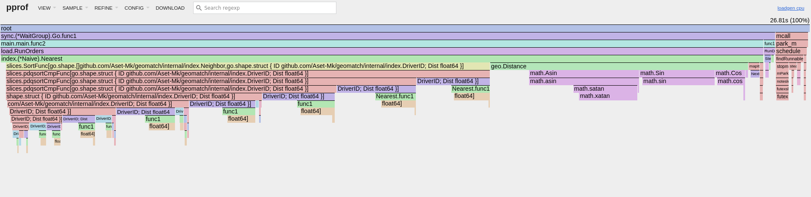
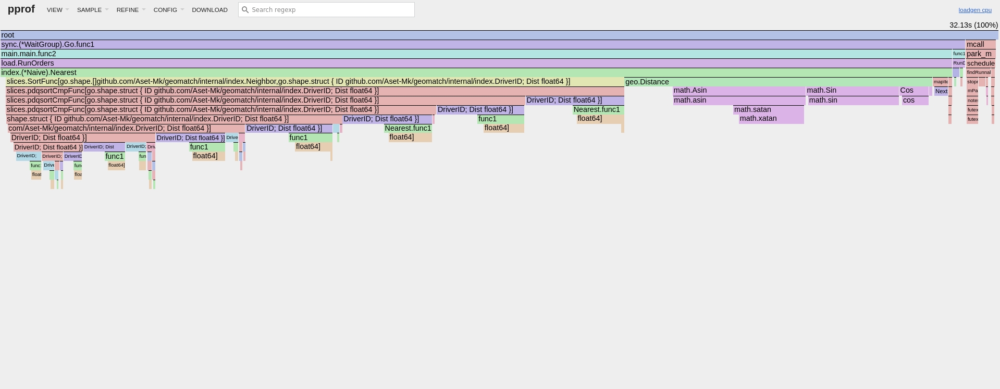

## Окружение

- **CPU:** Intel Core i7-12700H, 20 потоков
- **RAM:** 16 GB
- **ОС:** Linux 7.2 (Arch)
- **Go:** 1.27.3
- **Режим процессора:** performance, ноутбук от сети

## Как повторить

```
$ echo performance | sudo tee /sys/devices/system/cpu/cpu*/cpufreq/scaling_governor
$ make build
$ ORDER_RATE=10 ./bin/loadgen
$ ORDER_RATE=20 ./bin/loadgen
$ ORDER_RATE=30 ./bin/loadgen
$ ORDER_RATE=40 ./bin/loadgen
$ ORDER_RATE=50 ./bin/loadgen
$ ORDER_RATE=60 ./bin/loadgen
$ ORDER_RATE=61 ./bin/loadgen
$ ORDER_RATE=62 ./bin/loadgen
$ ORDER_RATE=63 ./bin/loadgen
$ ORDER_RATE=64 ./bin/loadgen
$ ORDER_RATE=65 ./bin/loadgen
$ ORDER_RATE=66 ./bin/loadgen
$ ORDER_RATE=67 ./bin/loadgen
$ ORDER_RATE=68 ./bin/loadgen
$ ORDER_RATE=69 ./bin/loadgen
$ ORDER_RATE=70 ./bin/loadgen
$ ORDER_RATE=1000 ./bin/loadgen


$ ORDER_RATE=50 CPU_PROFILE=cpu.prof ./bin/loadgen
$ go tool pprof -top -nodecount=15 bin/loadgen cpu.prof
$ go tool pprof -http=:8080 bin/loadgen cpu.prof

$ ORDER_RATE=63 CPU_PROFILE=cpu63.prof ./bin/loadgen
$ go tool pprof -top -nodecount=15 bin/loadgen cpu63.prof
$ go tool pprof -http=:8080 bin/loadgen cpu63.prof

$ echo powersave | sudo tee /sys/devices/system/cpu/cpu*/cpufreq/scaling_governor
```

## 2026-10-23 Наивный индекс

Map под одним мьютексом. `Nearest` перебирает всех водителей и сортирует по расстоянию. Коммит `cb3c785`.

ORDER_RATE меняется от прогона к прогону. Параметры по умолчанию:

```
DRIVERS=100000      водителей
UPDATE_PERIOD=2s    каждый водитель обновляет координаты раз в 2 с
DURATION=30s        длительность прогона
SEED=1              сценарий случайных чисел
OUT=results.json    файл с итогом
```

Задержка при разной частоте заказов. Значение таблицы - медиана по 5 прогонам на частоту. У 1000 все процентили упёрлись в верхнюю границу гистограммы:

| Заказов/с |   p50 (ms) |   p99 (ms) | p99.9 (ms) |   max (ms) | Прогон шёл (s) |
|-----------|------------|------------|------------|------------|----------------|
|        10 |       16.9 |       23.3 |       25.5 |       25.5 |           30.0 |
|        20 |       17.0 |       23.9 |       25.3 |       26.0 |           30.0 |
|        30 |       16.9 |       23.6 |       25.4 |       25.7 |           30.0 |
|        40 |       16.9 |       23.3 |       25.6 |       25.8 |           30.0 |
|        50 |       16.8 |       23.1 |       25.8 |       25.9 |           30.0 |
|        60 |       17.0 |       25.4 |       27.2 |       28.0 |           30.0 |
|        61 |       17.5 |       25.4 |       26.2 |       26.9 |           30.0 |
|        62 |       44.1 |       79.7 |       81.7 |       81.8 |           30.0 |
|        63 |      276.7 |      466.9 |      469.8 |      469.8 |           30.5 |
|        64 |      541.2 |    1 065.0 |    1 070.1 |    1 071.1 |           31.1 |
|        65 |      788.5 |    1 547.3 |    1 558.5 |    1 559.6 |           31.6 |
|        66 |    1 041.9 |    2 001.9 |    2 016.3 |    2 017.3 |           32.0 |
|        67 |    1 272.8 |    2 467.8 |    2 488.3 |    2 490.4 |           32.5 |
|        68 |    1 450.0 |    2 906.1 |    2 928.6 |    2 932.7 |           32.9 |
|        69 |    1 766.4 |    3 444.7 |    3 473.4 |    3 477.5 |           33.5 |
|        70 |    1 976.3 |    3 813.4 |    3 844.1 |    3 848.2 |           33.8 |
|      1000 | >   60 000 | >   60 000 | >   60 000 | >   60 000 |          482.5 |

- **Предел около 61 заказа/с.** Наивный подход держит около 61 заказа в секунду. Я хочу добиться чтобы около 1000 в секунду обрабатывал, поэтому он слабее в 16 раз чем нужно.


Профиль процессора при 50 заказах/с

| flat (s) | flat % | sum % | cum (s) | cum % | Функция                                 |
|----------|--------|-------|---------|-------|-----------------------------------------|
|     6.68 |  24.92 | 24.92 |    7.10 | 26.48 | `cmp.Compare[float64]`                  |
|     6.39 |  23.83 | 48.75 |   13.38 | 49.91 | `slices.partitionCmpFunc[Neighbor]`     |
|     2.39 |   8.91 | 57.67 |    2.41 |  8.99 | `math.sin`                              |
|     1.94 |   7.24 | 64.90 |    1.94 |  7.24 | `math.xatan`                            |
|     1.46 |   5.45 | 70.35 |    3.65 | 13.61 | `math.asin`                             |
|     1.29 |   4.81 | 75.16 |    8.55 | 31.89 | `geo.Distance`                          |
|     1.05 |   3.92 | 79.07 |    1.85 |  6.90 | `slices.insertionSortCmpFunc[Neighbor]` |
|     1.04 |   3.88 | 82.95 |    1.10 |  4.10 | `math.cos`                              |
|     0.96 |   3.58 | 86.53 |    8.06 | 30.06 | `index.(*Naive).Nearest.func1`          |
|     0.51 |   1.90 | 88.44 |    0.51 |  1.90 | `runtime.futex`                         |
|     0.42 |   1.57 | 90.00 |    0.42 |  1.57 | `cmp.isNaN[float64]`                    |
|     0.23 |   0.86 | 90.86 |    0.31 |  1.16 | `maps.(*Iter).Next`                     |
|     0.23 |   0.86 | 91.72 |   16.04 | 59.83 | `slices.pdqsortCmpFunc[Neighbor]`       |
|     0.21 |   0.78 | 92.50 |    0.46 |  1.72 | `slices.order2CmpFunc[Neighbor]`        |
|     0.19 |   0.71 | 93.21 |    2.13 |  7.94 | `math.satan`                            |



Профиль при 63 заказах/с, выше предела. Доли почти те же, что при 50/с

| flat (s) | flat % | sum % | cum (s) | cum % | Функция                                 |
|----------|--------|-------|---------|-------|-----------------------------------------|
|     8.30 |  25.83 | 25.83 |    8.83 | 27.48 | `cmp.Compare[float64]`                  |
|     7.64 |  23.78 | 49.61 |   16.05 | 49.95 | `slices.partitionCmpFunc[Neighbor]`     |
|     2.97 |   9.24 | 58.85 |    2.97 |  9.24 | `math.sin`                              |
|     2.11 |   6.57 | 65.42 |    2.11 |  6.57 | `math.xatan`                            |
|     1.94 |   6.04 | 71.46 |    4.28 | 13.32 | `math.asin`                             |
|     1.56 |   4.86 | 76.31 |    2.71 |  8.43 | `slices.insertionSortCmpFunc[Neighbor]` |
|     1.55 |   4.82 | 81.14 |    9.92 | 30.87 | `geo.Distance`                          |
|     1.15 |   3.58 | 84.72 |    9.98 | 31.06 | `index.(*Naive).Nearest.func1`          |
|     0.91 |   2.83 | 87.55 |    0.96 |  2.99 | `math.cos`                              |
|     0.53 |   1.65 | 89.20 |    0.53 |  1.65 | `cmp.isNaN[float64]`                    |
|     0.50 |   1.56 | 90.76 |    0.50 |  1.56 | `runtime.futex`                         |
|     0.38 |   1.18 | 91.94 |    0.45 |  1.40 | `maps.(*Iter).Next`                     |
|     0.38 |   1.18 | 93.12 |   19.91 | 61.97 | `slices.pdqsortCmpFunc[Neighbor]`       |
|     0.19 |   0.59 | 93.71 |    0.59 |  1.84 | `slices.order2CmpFunc[Neighbor]`        |
|     0.18 |   0.56 | 94.27 |    2.29 |  7.13 | `math.satan`                            |



- **Причины задержки.** Почти всё время уходит на `index.(*Naive).Nearest`: около 60% на сортировку всех водителей (`slices.SortFunc`: 16.04 s при 50/с, 19.91 s при 63/с) и около 31% на расчёт расстояний (`geo.Distance`).

## 2026-10-25 Выбираем самый эффективный размер клетки

5 000 заказов/с:

| Клетка (m) | p50 (ns) | p99 (ns) | p99.9 (ns) | max (ns) | Прогон шёл (s) |
|------------|----------|----------|------------|----------|----------------|
|        100 |    4 731 |   11 871 |     36 063 |  554 495 |           30.0 |
|        150 |    3 197 |   10 015 |     32 431 |  483 071 |           30.0 |
|        200 |    3 525 |    9 655 |     28 271 |  576 511 |           30.0 |
|        250 |    4 423 |    8 151 |     29 439 |  531 455 |           30.0 |
|        300 |    5 715 |    9 791 |     31 439 |  563 711 |           30.0 |
|        350 |    7 143 |   12 135 |     31 087 |  540 671 |           30.0 |
|        400 |    8 839 |   13 783 |     34 111 |  547 327 |           30.0 |
|        500 |   12 615 |   18 575 |     41 823 |  561 151 |           30.0 |

50 000 заказов/с:

| Клетка (m) | p50 (ns) | p99 (ns) | p99.9 (ns) | max (ns) | Прогон шёл (s) |
|------------|----------|----------|------------|----------|----------------|
|        100 |    3 923 |   14 519 |     78 271 |  656 895 |           30.0 |
|        150 |    2 795 |    9 879 |     72 383 |  616 447 |           30.0 |
|        200 |    3 259 |    8 407 |     67 711 |  621 055 |           30.0 |
|        250 |    4 243 |    7 835 |     61 119 |  660 479 |           30.0 |
|        300 |    5 547 |   10 127 |     72 895 |  632 831 |           30.0 |
|        350 |    7 067 |   12 615 |     77 375 |  639 487 |           30.0 |
|        400 |    8 743 |   15 863 |     99 775 |  658 943 |           30.0 |
|        500 |   12 623 |   32 767 |    272 383 |  742 911 |           30.0 |

Бенчмарки одного вызова без нагрузки (`go test -run='^$' -bench=. -benchmem -count=5 ./internal/index/`), медиана по 5 запускам:

| Клетка (m) | Nearest (ns) | Upsert (ns) | Upsert (B/op) |
|------------|--------------|-------------|---------------|
|        100 |        3 312 |         203 |            27 |
|        150 |        3 171 |         166 |             6 |
|        200 |        3 080 |         150 |             1 |
|        250 |        3 850 |         155 |             1 |
|        300 |        5 038 |         154 |             1 |
|        350 |        6 429 |         149 |             1 |
|        400 |        8 026 |         145 |             0 |
|        500 |       11 646 |         135 |             0 |

- **Размер клетки по умолчанию 200 m.** Лучший p50 у 150 m, лучший p99 у 250 m, 200 m второй по обоим и лучший в бенчмарке `Nearest`. Крупнее 250 m растёт перебор внутри клетки, мельче 150 m — число колец и цена `Upsert`.

## 2026-10-25 Сетка

Водители разложены по квадратным клеткам. `Nearest` обходит клетки кольцами от клетки заказа и останавливается, когда дальше гарантированно нет никого ближе.

```
$ INDEX=grid CELL_SIZE=500 ORDER_RATE=60000 ./bin/loadgen
```

| Заказов/с | p50 (ms) | p99 (ms) | p99.9 (ms) | max (ms) | Прогон шёл (s) |
|-----------|----------|----------|------------|----------|----------------|
|     1 000 |    0.013 |    0.019 |      0.039 |    0.427 |           30.0 |
|    10 000 |    0.012 |    0.017 |      0.041 |    0.620 |           30.0 |
|    20 000 |    0.012 |    0.021 |      0.059 |    0.658 |           30.0 |
|    40 000 |    0.012 |    0.024 |      0.101 |    0.666 |           30.0 |
|    60 000 |    0.012 |    0.277 |      1.018 |    1.829 |           30.0 |
|    64 000 |    0.012 |    0.440 |      1.440 |    1.913 |           30.0 |
|    68 000 |    0.012 |    0.877 |      1.822 |    3.219 |           30.0 |
|    72 000 |    0.013 |    2.305 |      5.123 |    5.995 |           30.0 |
|    76 000 |    0.055 |   10.975 |     11.703 |   11.839 |           30.0 |
|    80 000 |  271.871 |  582.655 |    587.263 |  587.775 |           30.6 |

## 2026-10-26 Горутины для заказов

Заказы идут из нескольких горутин одновременно `ORDER_WORKERS`, водители обновляются из одной. Сетка 200 m, медиана по 5 прогонам.

```
$ INDEX=grid ORDER_WORKERS=8 ORDER_RATE=200000 UPDATE_BATCH=100 ./bin/loadgen
```

Варианты для блокировки каналов чтобы не происходила гонка:

|          Вариант | Заказов/с |   p50 (ms) |   p99 (ms) | p99.9 (ms) |   max (ms) | Прогон шёл (s) |
|------------------|-----------|------------|------------|------------|------------|----------------|
|            Mutex |    50 000 |      0.006 |      0.038 |      0.065 |      1.142 |           30.0 |
|            Mutex |   100 000 |      0.006 |      0.041 |      0.079 |      1.103 |           30.0 |
|            Mutex |   200 000 |      0.014 |      0.561 |      2.261 |      6.403 |           30.0 |
|            Mutex |   300 000 |      0.840 |     13.951 |     24.783 |     40.319 |           30.0 |
|          RWMutex |    50 000 |      0.005 |      0.028 |      0.052 |      1.030 |           30.0 |
|          RWMutex |   100 000 |      0.006 |      0.037 |      0.066 |      0.848 |           30.0 |
|          RWMutex |   200 000 |      0.006 |      0.041 |      0.090 |      0.896 |           30.0 |
|          RWMutex |   300 000 |      0.006 |      0.701 |      2.085 |      4.555 |           30.0 |
| владелец + канал |    50 000 |      0.017 |      0.046 |      0.066 |      0.639 |           30.0 |
| владелец + канал |   100 000 |      0.013 |      0.041 |      0.068 |      0.580 |           30.0 |
| владелец + канал |   200 000 |      0.027 |      0.294 |      1.248 |      2.855 |           30.0 |
| владелец + канал |   300 000 |  1 179.647 |  2 260.991 |  2 320.383 |  2 326.527 |           32.2 |
|   8 шардов по ID |    50 000 |      0.037 |      0.104 |      0.174 |      0.923 |           30.0 |
|   8 шардов по ID |   100 000 |      0.052 |      1.082 |      2.069 |      3.493 |           30.0 |
|   8 шардов по ID |   200 000 |  8 716.287 | 17 711.103 | 17 891.327 | 17 924.095 |           47.9 |
|   8 шардов по ID |   300 000 | 20 791.295 | 41 091.071 | 41 484.287 | 41 517.055 |           71.5 |

- **Перемерено 2026-11-06 с исправленным ожиданием в генераторе**, пачка 1, 8 горутин заказов. `RWMutex` по-прежнему лучше всех.
- **Владелец + канал при 300 000/с не успевает**: одна горутина делает все поиски, p50 1.2 s. Шарды не успевают уже при 200 000/с.

Видим из этой таблицы что лучше `RWMutex`

`RWMutex` при 200 000 заказов/с и разном числе горутин заказов:

| Горутин заказов | p50 (ms) | p99 (ms) | p99.9 (ms) | max (ms) | Прогон шёл (s) |
|-----------------|----------|----------|------------|----------|----------------|
|               1 |    0.003 |    0.076 |      0.474 |    1.316 |           30.0 |
|               2 |    0.003 |    0.033 |      0.158 |    0.681 |           30.0 |
|               4 |    0.003 |    0.017 |      0.098 |    2.081 |           30.0 |
|               8 |    0.005 |    0.040 |      0.086 |    0.927 |           30.0 |
|              16 |    0.021 |    0.193 |      0.302 |    1.421 |           30.1 |

- **Перемерено 2026-11-06**, пачка 1. Лучше всего 4 горутины: p99 0.017 ms, у 8 горутин 0.040 ms, у 16 уже 0.193 ms. Почему с 16 хуже, не проверено.

Обновления водителей пачками `UPDATE_BATCH`, 8 горутин заказов:

|   Замок | Заказов/с | Пачка | p50 (ms) | p99 (ms) | p99.9 (ms) | max (ms) | Прогон шёл (s) |
|---------|-----------|-------|----------|----------|------------|----------|----------------|
|   Mutex |    50 000 |     1 |    0.006 |    0.038 |      0.065 |    1.067 |           30.0 |
|   Mutex |    50 000 |    10 |    0.006 |    0.037 |      0.067 |    1.178 |           30.0 |
|   Mutex |    50 000 |   100 |    0.006 |    0.039 |      0.066 |    1.182 |           30.0 |
|   Mutex |    50 000 | 1 000 |    0.006 |    0.051 |      0.088 |    1.361 |           30.0 |
|   Mutex |   200 000 |     1 |    0.013 |    0.583 |      2.347 |    7.995 |           30.0 |
|   Mutex |   200 000 |    10 |    0.011 |    0.614 |      2.219 |    6.591 |           30.0 |
|   Mutex |   200 000 |   100 |    0.013 |    0.465 |      2.159 |    6.331 |           30.0 |
|   Mutex |   200 000 | 1 000 |    0.010 |    0.586 |      2.345 |    7.179 |           30.0 |
|   Mutex |   300 000 |     1 |    0.794 |   14.095 |     22.751 |   39.935 |           30.0 |
|   Mutex |   300 000 |    10 |    1.140 |   16.895 |     27.999 |   39.295 |           30.0 |
|   Mutex |   300 000 |   100 |    1.694 |   29.679 |     57.375 |   74.559 |           30.0 |
|   Mutex |   300 000 | 1 000 |    2.353 |   38.111 |     62.303 |   80.127 |           30.0 |
| RWMutex |    50 000 |     1 |    0.004 |    0.021 |      0.040 |    1.807 |           30.0 |
| RWMutex |    50 000 |    10 |    0.005 |    0.030 |      0.054 |    1.103 |           30.0 |
| RWMutex |    50 000 |   100 |    0.006 |    0.035 |      0.060 |    1.807 |           30.0 |
| RWMutex |    50 000 | 1 000 |    0.006 |    0.043 |      0.081 |    1.984 |           30.0 |
| RWMutex |   200 000 |     1 |    0.006 |    0.038 |      0.085 |    0.889 |           30.0 |
| RWMutex |   200 000 |    10 |    0.005 |    0.029 |      0.070 |    0.966 |           30.0 |
| RWMutex |   200 000 |   100 |    0.005 |    0.036 |      0.074 |    2.017 |           30.0 |
| RWMutex |   200 000 | 1 000 |    0.005 |    0.048 |      0.098 |    1.021 |           30.0 |
| RWMutex |   300 000 |     1 |    0.006 |    0.592 |      1.974 |    4.827 |           30.0 |
| RWMutex |   300 000 |    10 |    0.005 |    0.030 |      0.100 |    1.829 |           30.0 |
| RWMutex |   300 000 |   100 |    0.005 |    0.048 |      0.093 |    1.113 |           30.0 |
| RWMutex |   300 000 | 1 000 |    0.005 |    0.054 |      0.106 |    0.863 |           30.0 |

- **Перемерено 2026-11-06 с исправленным ожиданием в генераторе.** Прежние цифры были завышены, особенно у `Mutex`: при 200 000/с p99 был 16 ms, стал 0.5 ms.
- **`RWMutex` с пачками держит 300 000 заказов/с**: p99 от 0.030 до 0.054 ms, без пачек 0.592 ms.
- **Лучшая пачка 10.** При 200 000 и 300 000/с p99 0.029 и 0.030 ms, у пачки 100 0.036 и 0.048 ms. При 50 000/с лучше всего без пачек, 0.021 ms.
- **Без пачек `RWMutex` при 50 000/с не хуже `Mutex`**: 0.021 ms против 0.038 ms. Прежний замер показывал обратное из-за цикла ожидания в генераторе.
- **Пачка 1 000 хуже всех у `RWMutex`**: писатель держит замок дольше, и это видно в p99.
- **`Mutex` пачки не помогают**: там ждут друг друга сами `Nearest`, при 300 000/с p99 от 14 до 38 ms.
- **Шарды по ID хуже всех**: каждый поиск обходит все шарды, и в каждом водители в 8 раз реже.

Число горутин заказов вместе с размером пачки, 2026-11-06:

```
$ INDEX=grid ORDER_WORKERS=4 UPDATE_BATCH=10 ORDER_RATE=200000 ./bin/loadgen
```

| Горутин | Пачка | Заказов/с | p50 (ms) | p99 (ms) | p99.9 (ms) | max (ms) | Прогон шёл (s) |
|---------|-------|-----------|----------|----------|------------|----------|----------------|
|       4 |    10 |    50 000 |    0.004 |    0.012 |      0.029 |    1.061 |           30.0 |
|       4 |    10 |   200 000 |    0.003 |    0.012 |      0.057 |    1.497 |           30.0 |
|       4 |    10 |   300 000 |    0.003 |    0.024 |      0.098 |    1.829 |           30.0 |
|       4 |   100 |    50 000 |    0.004 |    0.012 |      0.029 |    1.062 |           30.0 |
|       4 |   100 |   200 000 |    0.003 |    0.021 |      0.060 |    1.267 |           30.0 |
|       4 |   100 |   300 000 |    0.003 |    0.029 |      0.098 |    1.990 |           30.0 |
|       8 |    10 |    50 000 |    0.006 |    0.033 |      0.059 |    1.009 |           30.0 |
|       8 |    10 |   200 000 |    0.005 |    0.028 |      0.066 |    1.211 |           30.0 |
|       8 |    10 |   300 000 |    0.005 |    0.031 |      0.095 |    1.387 |           30.0 |
|       8 |   100 |    50 000 |    0.006 |    0.035 |      0.059 |    0.981 |           30.0 |
|       8 |   100 |   200 000 |    0.005 |    0.035 |      0.075 |    1.355 |           30.0 |
|       8 |   100 |   300 000 |    0.005 |    0.048 |      0.094 |    2.028 |           30.0 |

- **Выбраны 4 горутины и пачка 10.** На любой нагрузке у них самый низкий p99: 0.012 ms при 50 000 и 200 000/с, 0.024 ms при 300 000/с. У прежнего выбора, 8 горутин с пачкой 100, при 200 000 и 300 000/с 0.035 и 0.048 ms.
- **При 50 000/с размер пачки не важен**, а число горутин важно: у 4 горутин 0.012 ms, у 8 горутин от 0.033 до 0.035 ms.

## 2026-10-27 Память и GC

Сетка 200 m, 8 горутин заказов, пачки по 100, прогоны по 20 s, медиана по 5 прогонам.

```
$ GODEBUG=gctrace=1 INDEX=grid ORDER_WORKERS=8 UPDATE_BATCH=100 ORDER_RATE=200000 DURATION=20s ./bin/loadgen
```

- **GC почти не работает.** Живая куча 17 MB, при 50 000 заказов/с GC запускается раз в 2.5 s, при 200 000/с раз в 0.8 s. Паузы STW от 0.02 до 0.12 ms, доля процессора на GC около 0%. На заказ выделяется около 100 B, это срез результата `Nearest`.

`GOGC` и `GOMEMLIMIT` при 200 000 заказов/с, медиана по 3 прогонам. Снято до исправления ожидания в генераторе, поэтому p99 тут завышен, но между собой строки сравнивать можно:

| Настройка                    | Запусков GC за 20 s | Память (MB) | p99 (ms) |
|------------------------------|---------------------|-------------|----------|
| `GOGC=100`                   |                  26 |          48 |    0.195 |
| `GOGC=50`                    |                  52 |          39 |    0.208 |
| `GOGC=200`                   |                  13 |          66 |    0.195 |
| `GOGC=400`                   |                   7 |          99 |    0.226 |
| `GOGC=off`                   |                   0 |         396 |    0.221 |
| `GOGC=off GOMEMLIMIT=64MiB`  |                  12 |          62 |    0.194 |
| `GOGC=off GOMEMLIMIT=256MiB` |                   1 |         245 |    0.207 |

- **`GOGC` и `GOMEMLIMIT` на задержку не влияют**, меняется только память. Оставил по умолчанию.

Откуда max около 3 ms. Записал `runtime/trace` и разобрал заказы дольше 0.5 ms: 86% их времени горутина была `Runnable`, 12% работала, 2% ждала замок. Горутина заказа ждёт `RLock`, пока пишут водители, писатель её будит, и она попадает в очередь того же ядра. Горутины заказов в ожидании своего времени крутятся в цикле и ядро не отдают, поэтому разбуженная ждёт около 3 ms, пока её не заберёт другое ядро. То есть хвост давал генератор нагрузки.

Ожидание заказа с `runtime.Gosched()`, 200 000 заказов/с:

| Ожидание                        | p50 (ms) | p99 (ms) | p99.9 (ms) | max (ms) |
|---------------------------------|----------|----------|------------|----------|
| крутится без уступок            |    0.005 |    0.222 |      0.473 |    3.249 |
| уступает всегда                 |    0.009 |    0.052 |      0.088 |    0.901 |
| уступает, пока больше 50 us     |    0.005 |    0.256 |      0.797 |    3.223 |
| уступает, пока больше 5 us      |    0.006 |    0.050 |      0.088 |    0.997 |

- **Выбрано 5 us.** p99 как у варианта «всегда», а p50 почти как без уступок. При 50 us на 200 000/с до заказа почти никогда не остаётся больше 50 us, и уступок не происходит.
- **Уступать ядро в горутине водителей после пачки не помогает**: p99 0.234 ms, max 3.487 ms.

Плоская сетка: клетка хранит срез водителей вместо map, `pos` помнит клетку и место в срезе. Бенчмарки (`go test -run='^$' -bench=. -benchmem ./internal/index/`), медиана по 3:

| Бенчмарк                     | Было (ns) | Плоская (ns) |
|------------------------------|-----------|--------------|
| `Nearest`, 100 000 водителей |     3 100 |        2 652 |
| `Nearest`, 10 000            |     2 691 |        2 171 |
| `Nearest`, 3 000             |     3 657 |        3 122 |
| `Nearest`, 1 000             |     5 841 |        5 064 |
| `Upsert`                     |       166 |          126 |

При 100 и 300 водителях без изменений.

Всё вместе в генераторе:

| Вариант                      | Заказов/с | Запусков GC | p50 (ms) | p99 (ms) | p99.9 (ms) | max (ms) |
|------------------------------|-----------|-------------|----------|----------|------------|----------|
| было                         |    50 000 |           9 |    0.005 |    0.076 |      0.235 |    3.017 |
| ожидание с уступками         |    50 000 |           9 |    0.007 |    0.040 |      0.067 |    0.835 |
| + плоская сетка              |    50 000 |          10 |    0.006 |    0.034 |      0.059 |    0.945 |
| + `Nearest` без аллокации    |    50 000 |           4 |    0.006 |    0.034 |      0.060 |    1.112 |
| было                         |   200 000 |          26 |    0.005 |    0.211 |      0.430 |    3.783 |
| ожидание с уступками         |   200 000 |          26 |    0.006 |    0.050 |      0.086 |    1.163 |
| + плоская сетка              |   200 000 |          27 |    0.005 |    0.037 |      0.076 |    1.183 |
| + `Nearest` без аллокации    |   200 000 |           4 |    0.005 |    0.036 |      0.073 |    1.061 |

- **При 200 000 заказов/с p99 0.037 ms вместо 0.211 ms**, почти всё от исправления генератора.
- **`Nearest` без аллокации не взял.** Результат пишется в переданный срез, GC запускается 4 раза вместо 26, но задержка та же, а бенчмарк быстрее около 1%. `sync.Pool` тут не подходит, срез результата уходит вызывающему.
- **p99 и max в разделе про горутины были завышены** тем же циклом ожидания. Все три таблицы оттуда перемерены 2026-11-06.
- **max около 1 ms остался**, примерно один заказ на миллион. Похоже на планировщик ОС, не проверено.

## 2026-11-07 Предел

Те же замеры с исправленным генератором, чтобы сравнивать шаги в одних условиях.

Сетка 500 m, одна горутина заказов, без пачек, как в разделе про сетку:

```
$ INDEX=grid CELL_SIZE=500 ORDER_RATE=80000 ./bin/loadgen
```

| Заказов/с | p50 (ms) |  p99 (ms) | p99.9 (ms) |  max (ms) | Прогон шёл (s) |
|-----------|----------|-----------|------------|-----------|----------------|
|    40 000 |    0.011 |     0.022 |      0.077 |     0.295 |           30.0 |
|    60 000 |    0.011 |     1.358 |      2.819 |     4.223 |           30.0 |
|    64 000 |    0.011 |     1.454 |      3.249 |     5.095 |           30.0 |
|    68 000 |    0.011 |     1.471 |      3.879 |     5.735 |           30.0 |
|    72 000 |    0.011 |     1.599 |      4.143 |     6.263 |           30.0 |
|    76 000 |    0.011 |     2.279 |      5.951 |     7.203 |           30.0 |
|    80 000 |    0.012 |     3.205 |      8.063 |     8.943 |           30.0 |
|    90 000 |  656.895 | 1 236.991 |  1 246.207 | 1 246.207 |           31.2 |

- **Одна горутина держит около 80 000 заказов/с**, при 90 000 очередь растёт, p50 0.657 s. Раньше выходило около 72 000, тогда был `Mutex` и старый генератор.
- **p99 больше 1 ms уже с 60 000/с.** В разделе про сетку на 60 000 было 0.277 ms с `Mutex`. Почему с `RWMutex` без пачек хуже, не проверено.

Сетка 200 m, 4 горутины заказов, пачки по 10:

```
$ INDEX=grid ORDER_WORKERS=4 UPDATE_BATCH=10 ORDER_RATE=800000 ./bin/loadgen
```

| Заказов/с | p50 (ms) | p99 (ms) | p99.9 (ms) | max (ms) | Прогон шёл (s) |
|-----------|----------|----------|------------|----------|----------------|
|   300 000 |    0.003 |    0.017 |      0.071 |    2.703 |           30.0 |
|   400 000 |    0.003 |    0.048 |      0.144 |    1.686 |           30.0 |
|   500 000 |    0.003 |    0.061 |      0.154 |    1.603 |           30.0 |
|   600 000 |    0.003 |    0.210 |      0.993 |    3.133 |           30.0 |
|   800 000 |    0.005 |    0.587 |      1.672 |    3.365 |           30.0 |
| 1 000 000 |    4.251 |   25.727 |     30.415 |   32.319 |           30.0 |

- **Держит 800 000 заказов/с**, p99 0.587 ms. При 1 000 000 уже не успевает: p50 4.251 ms, в одном из 5 прогонов p99 0.778 s.
- **До 500 000/с p99 меньше 0.1 ms.**
- **При 300 000/с p99 0.017 ms, в прошлом замере было 0.024 ms.** Разница между днями, причину не искал.
