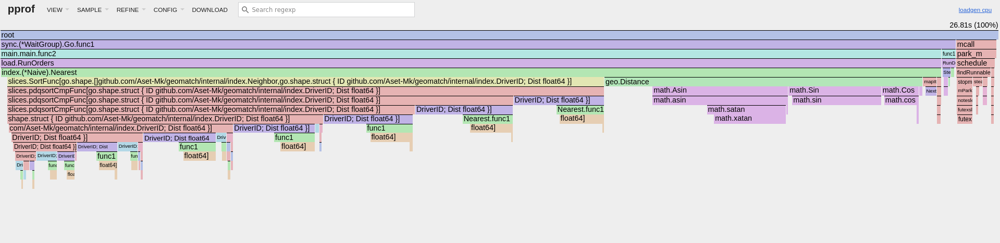
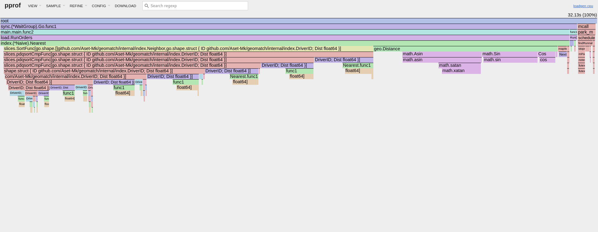

## Окружение

- **CPU:** Intel Core i7-12700H, 20 потоков
- **RAM:** 16 GB
- **ОС:** Linux 7.2 (Arch)
- **Go:** 1.27.3
- **Режим процессора:** performance, ноутбук от сети

## Как повторить

```
$ echo performance | sudo tee /sys/devices/system/cpu/cpu*/cpufreq/scaling_governor
$ make build
$ ORDER_RATE=10 ./bin/loadgen
$ ORDER_RATE=20 ./bin/loadgen
$ ORDER_RATE=30 ./bin/loadgen
$ ORDER_RATE=40 ./bin/loadgen
$ ORDER_RATE=50 ./bin/loadgen
$ ORDER_RATE=60 ./bin/loadgen
$ ORDER_RATE=61 ./bin/loadgen
$ ORDER_RATE=62 ./bin/loadgen
$ ORDER_RATE=63 ./bin/loadgen
$ ORDER_RATE=64 ./bin/loadgen
$ ORDER_RATE=65 ./bin/loadgen
$ ORDER_RATE=66 ./bin/loadgen
$ ORDER_RATE=67 ./bin/loadgen
$ ORDER_RATE=68 ./bin/loadgen
$ ORDER_RATE=69 ./bin/loadgen
$ ORDER_RATE=70 ./bin/loadgen
$ ORDER_RATE=1000 ./bin/loadgen


$ ORDER_RATE=50 CPU_PROFILE=cpu.prof ./bin/loadgen
$ go tool pprof -top -nodecount=15 bin/loadgen cpu.prof
$ go tool pprof -http=:8080 bin/loadgen cpu.prof

$ ORDER_RATE=63 CPU_PROFILE=cpu63.prof ./bin/loadgen
$ go tool pprof -top -nodecount=15 bin/loadgen cpu63.prof
$ go tool pprof -http=:8080 bin/loadgen cpu63.prof

$ echo powersave | sudo tee /sys/devices/system/cpu/cpu*/cpufreq/scaling_governor
```

## 2026-10-23 Наивный индекс

Map под одним мьютексом. `Nearest` перебирает всех водителей и сортирует по расстоянию. Коммит `cb3c785`.

ORDER_RATE меняется от прогона к прогону. Параметры по умолчанию:

```
DRIVERS=100000      водителей
UPDATE_PERIOD=2s    каждый водитель обновляет координаты раз в 2 с
DURATION=30s        длительность прогона
SEED=1              сценарий случайных чисел
OUT=results.json    файл с итогом
```

Задержка при разной частоте заказов. Значение таблицы - медиана по 5 прогонам на частоту. У 1000 все процентили упёрлись в верхнюю границу гистограммы:

| Заказов/с |   p50 (ms) |   p99 (ms) | p99.9 (ms) |   max (ms) | Прогон шёл (s) |
|-----------|------------|------------|------------|------------|----------------|
|        10 |       16.9 |       23.3 |       25.5 |       25.5 |           30.0 |
|        20 |       17.0 |       23.9 |       25.3 |       26.0 |           30.0 |
|        30 |       16.9 |       23.6 |       25.4 |       25.7 |           30.0 |
|        40 |       16.9 |       23.3 |       25.6 |       25.8 |           30.0 |
|        50 |       16.8 |       23.1 |       25.8 |       25.9 |           30.0 |
|        60 |       17.0 |       25.4 |       27.2 |       28.0 |           30.0 |
|        61 |       17.5 |       25.4 |       26.2 |       26.9 |           30.0 |
|        62 |       44.1 |       79.7 |       81.7 |       81.8 |           30.0 |
|        63 |      276.7 |      466.9 |      469.8 |      469.8 |           30.5 |
|        64 |      541.2 |    1 065.0 |    1 070.1 |    1 071.1 |           31.1 |
|        65 |      788.5 |    1 547.3 |    1 558.5 |    1 559.6 |           31.6 |
|        66 |    1 041.9 |    2 001.9 |    2 016.3 |    2 017.3 |           32.0 |
|        67 |    1 272.8 |    2 467.8 |    2 488.3 |    2 490.4 |           32.5 |
|        68 |    1 450.0 |    2 906.1 |    2 928.6 |    2 932.7 |           32.9 |
|        69 |    1 766.4 |    3 444.7 |    3 473.4 |    3 477.5 |           33.5 |
|        70 |    1 976.3 |    3 813.4 |    3 844.1 |    3 848.2 |           33.8 |
|      1000 | >   60 000 | >   60 000 | >   60 000 | >   60 000 |          482.5 |

- **Предел около 61 заказа/с.** Наивный подход держит около 61 заказа в секунду. Я хочу добиться чтобы около 1000 в секунду обрабатывал, поэтому он слабее в 16 раз чем нужно.


Профиль процессора при 50 заказах/с

| flat (s) | flat % | sum % | cum (s) | cum % | Функция                                 |
|----------|--------|-------|---------|-------|-----------------------------------------|
|     6.68 |  24.92 | 24.92 |    7.10 | 26.48 | `cmp.Compare[float64]`                  |
|     6.39 |  23.83 | 48.75 |   13.38 | 49.91 | `slices.partitionCmpFunc[Neighbor]`     |
|     2.39 |   8.91 | 57.67 |    2.41 |  8.99 | `math.sin`                              |
|     1.94 |   7.24 | 64.90 |    1.94 |  7.24 | `math.xatan`                            |
|     1.46 |   5.45 | 70.35 |    3.65 | 13.61 | `math.asin`                             |
|     1.29 |   4.81 | 75.16 |    8.55 | 31.89 | `geo.Distance`                          |
|     1.05 |   3.92 | 79.07 |    1.85 |  6.90 | `slices.insertionSortCmpFunc[Neighbor]` |
|     1.04 |   3.88 | 82.95 |    1.10 |  4.10 | `math.cos`                              |
|     0.96 |   3.58 | 86.53 |    8.06 | 30.06 | `index.(*Naive).Nearest.func1`          |
|     0.51 |   1.90 | 88.44 |    0.51 |  1.90 | `runtime.futex`                         |
|     0.42 |   1.57 | 90.00 |    0.42 |  1.57 | `cmp.isNaN[float64]`                    |
|     0.23 |   0.86 | 90.86 |    0.31 |  1.16 | `maps.(*Iter).Next`                     |
|     0.23 |   0.86 | 91.72 |   16.04 | 59.83 | `slices.pdqsortCmpFunc[Neighbor]`       |
|     0.21 |   0.78 | 92.50 |    0.46 |  1.72 | `slices.order2CmpFunc[Neighbor]`        |
|     0.19 |   0.71 | 93.21 |    2.13 |  7.94 | `math.satan`                            |



Профиль при 63 заказах/с, выше предела. Доли почти те же, что при 50/с

| flat (s) | flat % | sum % | cum (s) | cum % | Функция                                 |
|----------|--------|-------|---------|-------|-----------------------------------------|
|     8.30 |  25.83 | 25.83 |    8.83 | 27.48 | `cmp.Compare[float64]`                  |
|     7.64 |  23.78 | 49.61 |   16.05 | 49.95 | `slices.partitionCmpFunc[Neighbor]`     |
|     2.97 |   9.24 | 58.85 |    2.97 |  9.24 | `math.sin`                              |
|     2.11 |   6.57 | 65.42 |    2.11 |  6.57 | `math.xatan`                            |
|     1.94 |   6.04 | 71.46 |    4.28 | 13.32 | `math.asin`                             |
|     1.56 |   4.86 | 76.31 |    2.71 |  8.43 | `slices.insertionSortCmpFunc[Neighbor]` |
|     1.55 |   4.82 | 81.14 |    9.92 | 30.87 | `geo.Distance`                          |
|     1.15 |   3.58 | 84.72 |    9.98 | 31.06 | `index.(*Naive).Nearest.func1`          |
|     0.91 |   2.83 | 87.55 |    0.96 |  2.99 | `math.cos`                              |
|     0.53 |   1.65 | 89.20 |    0.53 |  1.65 | `cmp.isNaN[float64]`                    |
|     0.50 |   1.56 | 90.76 |    0.50 |  1.56 | `runtime.futex`                         |
|     0.38 |   1.18 | 91.94 |    0.45 |  1.40 | `maps.(*Iter).Next`                     |
|     0.38 |   1.18 | 93.12 |   19.91 | 61.97 | `slices.pdqsortCmpFunc[Neighbor]`       |
|     0.19 |   0.59 | 93.71 |    0.59 |  1.84 | `slices.order2CmpFunc[Neighbor]`        |
|     0.18 |   0.56 | 94.27 |    2.29 |  7.13 | `math.satan`                            |



- **Причины задержки.** Почти всё время уходит на `index.(*Naive).Nearest`: около 60% на сортировку всех водителей (`slices.SortFunc`: 16.04 s при 50/с, 19.91 s при 63/с) и около 31% на расчёт расстояний (`geo.Distance`).

## 2026-10-25 Выбираем самый эффективный размер клетки

5 000 заказов/с:

| Клетка (m) | p50 (ns) | p99 (ns) | p99.9 (ns) | max (ns) | Прогон шёл (s) |
|------------|----------|----------|------------|----------|----------------|
|        100 |    4 731 |   11 871 |     36 063 |  554 495 |           30.0 |
|        150 |    3 197 |   10 015 |     32 431 |  483 071 |           30.0 |
|        200 |    3 525 |    9 655 |     28 271 |  576 511 |           30.0 |
|        250 |    4 423 |    8 151 |     29 439 |  531 455 |           30.0 |
|        300 |    5 715 |    9 791 |     31 439 |  563 711 |           30.0 |
|        350 |    7 143 |   12 135 |     31 087 |  540 671 |           30.0 |
|        400 |    8 839 |   13 783 |     34 111 |  547 327 |           30.0 |
|        500 |   12 615 |   18 575 |     41 823 |  561 151 |           30.0 |

50 000 заказов/с:

| Клетка (m) | p50 (ns) | p99 (ns) | p99.9 (ns) | max (ns) | Прогон шёл (s) |
|------------|----------|----------|------------|----------|----------------|
|        100 |    3 923 |   14 519 |     78 271 |  656 895 |           30.0 |
|        150 |    2 795 |    9 879 |     72 383 |  616 447 |           30.0 |
|        200 |    3 259 |    8 407 |     67 711 |  621 055 |           30.0 |
|        250 |    4 243 |    7 835 |     61 119 |  660 479 |           30.0 |
|        300 |    5 547 |   10 127 |     72 895 |  632 831 |           30.0 |
|        350 |    7 067 |   12 615 |     77 375 |  639 487 |           30.0 |
|        400 |    8 743 |   15 863 |     99 775 |  658 943 |           30.0 |
|        500 |   12 623 |   32 767 |    272 383 |  742 911 |           30.0 |

Бенчмарки одного вызова без нагрузки (`go test -run='^$' -bench=. -benchmem -count=5 ./internal/index/`), медиана по 5 запускам:

| Клетка (m) | Nearest (ns) | Upsert (ns) | Upsert (B/op) |
|------------|--------------|-------------|---------------|
|        100 |        3 312 |         203 |            27 |
|        150 |        3 171 |         166 |             6 |
|        200 |        3 080 |         150 |             1 |
|        250 |        3 850 |         155 |             1 |
|        300 |        5 038 |         154 |             1 |
|        350 |        6 429 |         149 |             1 |
|        400 |        8 026 |         145 |             0 |
|        500 |       11 646 |         135 |             0 |

- **Размер клетки по умолчанию 200 m.** Лучший p50 у 150 m, лучший p99 у 250 m, 200 m второй по обоим и лучший в бенчмарке `Nearest`. Крупнее 250 m растёт перебор внутри клетки, мельче 150 m — число колец и цена `Upsert`.

## 2026-10-25 Сетка

Водители разложены по квадратным клеткам. `Nearest` обходит клетки кольцами от клетки заказа и останавливается, когда дальше гарантированно нет никого ближе.

```
$ INDEX=grid CELL_SIZE=200 ORDER_RATE=60000 ./bin/loadgen
```

| Заказов/с | p50 (ms) | p99 (ms) | p99.9 (ms) | max (ms) | Прогон шёл (s) |
|-----------|----------|----------|------------|----------|----------------|
|     1 000 |    0.013 |    0.019 |      0.039 |    0.427 |           30.0 |
|    10 000 |    0.012 |    0.017 |      0.041 |    0.620 |           30.0 |
|    20 000 |    0.012 |    0.021 |      0.059 |    0.658 |           30.0 |
|    40 000 |    0.012 |    0.024 |      0.101 |    0.666 |           30.0 |
|    60 000 |    0.012 |    0.277 |      1.018 |    1.829 |           30.0 |
|    64 000 |    0.012 |    0.440 |      1.440 |    1.913 |           30.0 |
|    68 000 |    0.012 |    0.877 |      1.822 |    3.219 |           30.0 |
|    72 000 |    0.013 |    2.305 |      5.123 |    5.995 |           30.0 |
|    76 000 |    0.055 |   10.975 |     11.703 |   11.839 |           30.0 |
|    80 000 |  271.871 |  582.655 |    587.263 |  587.775 |           30.6 |

## 2026-10-26 Горутины для заказов

Заказы идут из нескольких горутин одновременно `ORDER_WORKERS`, водители обновляются из одной. Сетка 200 m, медиана по 5 прогонам.

```
$ INDEX=grid ORDER_WORKERS=8 ORDER_RATE=200000 UPDATE_BATCH=100 ./bin/loadgen
```

Варианты для блокировки каналов чтобы не происходила гонка:

|          Вариант | Заказов/с |   p50 (ms) |   p99 (ms) | p99.9 (ms) |   max (ms) | Прогон шёл (s) |
|------------------|-----------|------------|------------|------------|------------|----------------|
|            Mutex |    50 000 |      0.005 |      0.134 |      0.458 |      3.223 |           30.0 |
|            Mutex |   100 000 |      0.227 |      3.423 |      5.959 |     12.383 |           30.0 |
|            Mutex |   200 000 |      2.451 |     20.351 |     32.895 |     47.647 |           30.0 |
|            Mutex |   300 000 |  1 286.143 |  4 915.199 |  5 361.663 |  5 378.047 |           33.1 |
|          RWMutex |    50 000 |      0.044 |      0.329 |      0.509 |      1.309 |           30.2 |
|          RWMutex |   100 000 |      0.052 |      0.485 |      0.761 |      2.971 |           30.2 |
|          RWMutex |   200 000 |      0.123 |      1.122 |      1.929 |      3.817 |           30.2 |
|          RWMutex |   300 000 |      0.442 |      3.697 |      5.603 |      8.559 |           30.1 |
| владелец + канал |    50 000 |      0.027 |      0.078 |      0.133 |      1.102 |           30.0 |
| владелец + канал |   100 000 |      0.022 |      0.079 |      0.168 |      1.346 |           30.0 |
| владелец + канал |   200 000 |      0.276 |      2.277 |      4.037 |      5.923 |           30.0 |
| владелец + канал |   300 000 |  3 637.247 |  6 889.471 |  6 971.391 |  6 987.775 |           37.0 |
|   8 шардов по ID |    50 000 |      0.044 |      0.252 |      0.504 |      2.101 |           30.0 |
|   8 шардов по ID |   100 000 |      4.271 |    160.639 |    186.367 |    189.311 |           30.2 |
|   8 шардов по ID |   200 000 | 14 532.607 | 28 590.079 | 28 868.607 | 28 917.759 |           58.9 |
|   8 шардов по ID |   300 000 | 29 261.823 | 57 933.823 | 58 458.111 | 58 523.647 |           88.5 |

Видим из этой таблицы что лучше `RWMutex`

`RWMutex` при 200 000 заказов/с и разном числе горутин заказов:

| Горутин заказов | p50 (ms) | p99 (ms) | p99.9 (ms) | max (ms) | Прогон шёл (s) |
|-----------------|----------|----------|------------|----------|----------------|
|               1 |    0.003 |    0.977 |      2.239 |    3.525 |           30.0 |
|               2 |    0.008 |    2.685 |      4.155 |    6.607 |           30.0 |
|               4 |    0.118 |    1.499 |      2.821 |    4.843 |           30.0 |
|               8 |    0.113 |    1.049 |      1.799 |    4.059 |           30.1 |
|              16 |    0.078 |    0.883 |      1.374 |    3.289 |           30.2 |

Обновления водителей пачками `UPDATE_BATCH`, 8 горутин заказов:

|   Замок | Заказов/с | Пачка |  p50 (ms) |  p99 (ms) | p99.9 (ms) |  max (ms) | Прогон шёл (s) |
|---------|-----------|-------|-----------|-----------|------------|-----------|----------------|
|   Mutex |    50 000 |     1 |     0.006 |     0.203 |      0.528 |     3.531 |           30.0 |
|   Mutex |    50 000 |    10 |     0.005 |     0.165 |      0.506 |     3.379 |           30.0 |
|   Mutex |    50 000 |   100 |     0.005 |     0.163 |      0.463 |     2.381 |           30.0 |
|   Mutex |    50 000 | 1 000 |     0.004 |     0.582 |      1.161 |     3.223 |           30.0 |
|   Mutex |   200 000 |     1 |     2.381 |    20.175 |     31.855 |    51.935 |           30.0 |
|   Mutex |   200 000 |    10 |     2.107 |    17.375 |     26.351 |    42.111 |           30.0 |
|   Mutex |   200 000 |   100 |     2.000 |    16.359 |     23.823 |    35.455 |           30.0 |
|   Mutex |   200 000 | 1 000 |     2.006 |    16.527 |     25.247 |    38.463 |           30.0 |
|   Mutex |   300 000 |     1 | 1 323.007 | 3 246.079 |  3 327.999 | 3 360.767 |           33.0 |
|   Mutex |   300 000 |    10 | 1 455.103 | 3 319.807 |  3 479.551 | 3 504.127 |           33.1 |
|   Mutex |   300 000 |   100 | 2 248.703 | 4 796.415 |  4 947.967 | 4 972.543 |           34.3 |
|   Mutex |   300 000 | 1 000 | 2 164.735 | 6 107.135 |  6 311.935 | 6 352.895 |           34.3 |
| RWMutex |    50 000 |     1 |     0.034 |     0.313 |      0.473 |     1.185 |           30.2 |
| RWMutex |    50 000 |    10 |     0.005 |     0.238 |      0.438 |     2.949 |           30.0 |
| RWMutex |    50 000 |   100 |     0.005 |     0.078 |      0.218 |     3.003 |           30.0 |
| RWMutex |    50 000 | 1 000 |     0.004 |     0.417 |      0.873 |     3.559 |           30.0 |
| RWMutex |   200 000 |     1 |     0.117 |     1.082 |      1.815 |     3.845 |           30.2 |
| RWMutex |   200 000 |    10 |     0.005 |     0.301 |      1.095 |     4.423 |           30.0 |
| RWMutex |   200 000 |   100 |     0.005 |     0.205 |      0.408 |     3.431 |           30.0 |
| RWMutex |   200 000 | 1 000 |     0.004 |     0.506 |      0.927 |     3.603 |           30.0 |
| RWMutex |   300 000 |     1 |     0.457 |     3.897 |      5.955 |     9.359 |           30.1 |
| RWMutex |   300 000 |    10 |     0.005 |     0.304 |      1.453 |     3.735 |           30.0 |
| RWMutex |   300 000 |   100 |     0.005 |     0.205 |      0.461 |     3.351 |           30.0 |
| RWMutex |   300 000 | 1 000 |     0.004 |     0.526 |      0.935 |     3.667 |           30.0 |

- **Выбран `RWMutex` с пачками по 100.** При 300 000 заказов/с p99 0.205 ms против 3.897 ms без пачек, p50 около 0.005 ms на любой нагрузке.
- **Без пачек `RWMutex` хуже `Mutex` при 50 000/с**: писатель приходит 50 000 раз в секунду, и читатели ждут за ним. С пачкой по 100 он приходит в 100 раз реже.
- **Пачка 1 000 хуже, чем 100**: писатель держит замок дольше, и это видно в p99.
- **`Mutex` пачки не помогают**: там ждут друг друга сами `Nearest`.
- **Шарды по ID хуже всех**: каждый поиск обходит все шарды, и в каждом водители в 8 раз реже.